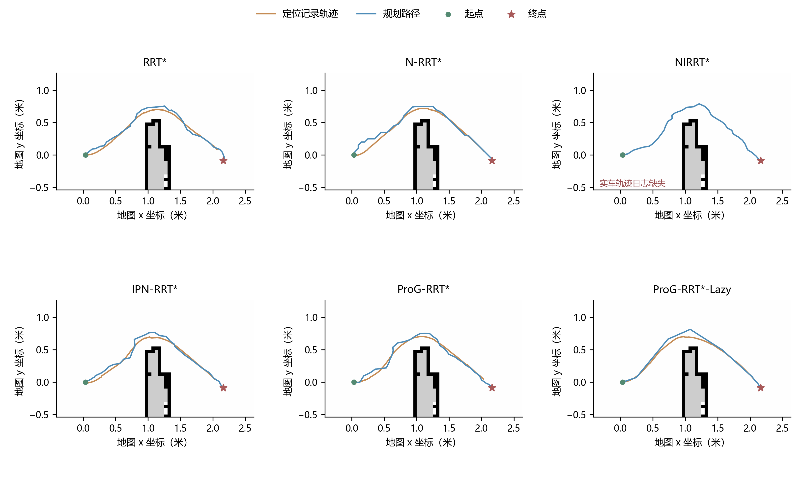
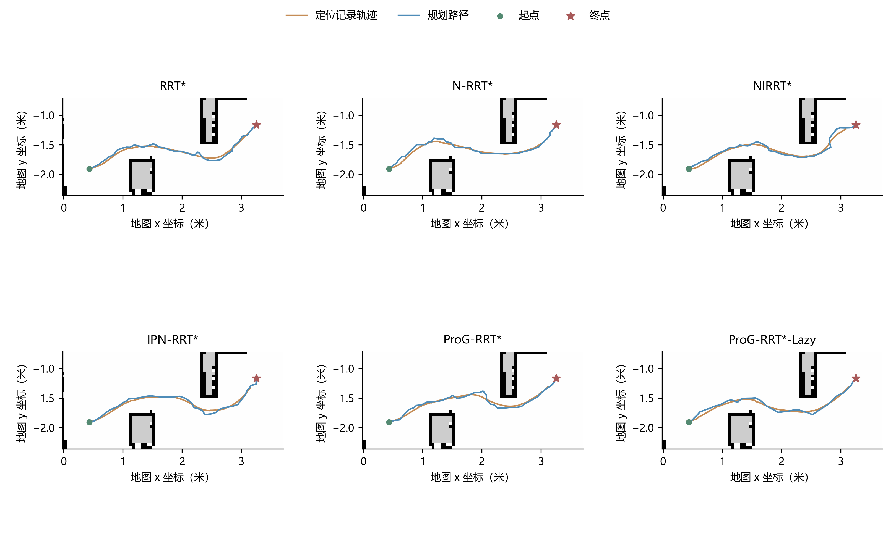

# 面向采样式路径规划的渐进点云引导与惰性验证

本仓库是 ProG-RRT* 与 ProG-RRT*-Lazy 的论文补充材料，展示两张真实场景地图上的规划对比、实车视频、路径图和可核对数据。

- [打开中文展示网页](https://fishsafe1896.github.io/ProG-RRT/)：直接播放 12 段主视频、查看逐场景结果。
- [下载原始视频](https://github.com/FishSafe1896/ProG-RRT/releases/tag/robot-validation-v1)：14 个原始文件，包含 12 段主视频和 2 段补充短剪辑。
- [下载三项规划指标完整数据](data/planning_comparison.csv)。
- [数据口径与复现说明](数据说明.md)。

## 方法介绍

ProGNet 对自由空间点云输出引导概率和五个路径阶段；ProG-RRT* 根据搜索树进度调节阶段采样偏好，初解后结合引导点与知情子集继续优化。ProG-RRT*-Lazy 增加阶段锚点和惰性图边验证，推迟候选连接的碰撞检查。两种方法每次规划只需一次 ProGNet 推理，实际可行性始终由几何碰撞检测决定。

对比方法名称与论文保持一致：RRT*、N-RRT*、NIRRT*、IPN-RRT*、ProG-RRT*、ProG-RRT*-Lazy。

## 实车规划对比

三项指标越小越好。表格显示精确数据的四位小数，CSV 保留源文件的数值精度。每个场景、每种算法为一条部署规划记录。

### 场景 1

| 算法 | 规划路径长度（米）↓ | 规划时间（秒）↓ | 迭代次数↓ |
| --- | ---: | ---: | ---: |
| RRT* | 2.8503 | 2.9719 | 2244 |
| N-RRT* | 2.8429 | 5.1966 | 3049 |
| NIRRT* | 2.8512 | 4.4772 | 762 |
| IPN-RRT* | 2.8401 | 2.1941 | 915 |
| ProG-RRT* | 2.8553 | 1.8637 | 484 |
| ProG-RRT*-Lazy | 2.7921 | 1.6289 | 19 |



[查看场景 1 的六种算法视频](https://fishsafe1896.github.io/ProG-RRT/#scene1)

### 场景 2

| 算法 | 规划路径长度（米）↓ | 规划时间（秒）↓ | 迭代次数↓ |
| --- | ---: | ---: | ---: |
| RRT* | 3.3437 | 6.7726 | 3860 |
| N-RRT* | 3.3468 | 15.0233 | 7016 |
| NIRRT* | 3.3381 | 4.1399 | 523 |
| IPN-RRT* | 3.3738 | 16.4884 | 5247 |
| ProG-RRT* | 3.3476 | 7.2445 | 2564 |
| ProG-RRT*-Lazy | 3.2934 | 2.1025 | 3075 |



[查看场景 2 的六种算法视频](https://fishsafe1896.github.io/ProG-RRT/#scene2)

## 数据含义

`planned_length_m` 是导出规划折线的长度，单位米；`planning_time_s` 是离线规划调用时间，单位秒，不包含模型加载、A* 参考计算、绘图或传输；`iterations` 是实际规划迭代数。规划在内部路径代价达到栅格 A* 参考的 1.03 倍阈值，或达到 10,000 次迭代时停止。

模型和规划运行于 Windows 端，机器人接收导出的路径并使用统一跟踪控制器执行。规划时间与实车行驶时间分别记录，视频播放时长也不等于这两项时间。本次材料中有 12 条规划记录和 11 份实车轨迹日志；场景 1 的 NIRRT* 日志缺失，不能将缺失日志当作算法失败。逐方法单次展示不构成重复试验统计比较。

## 文件索引

```text
docs/                       中文展示网页、图片和播放版视频
data/planning_comparison.csv 三项规划指标及原始方法键名
data/run_records.json       扩展记录与实车日志完整性标记
data/evidence/              原始路径、定位轨迹、所需规划元数据
data/maps/                  两张原始栅格地图及相对路径配置
data/video_manifest.json    原视频/播放版校验值和对应关系
scripts/                   数据核验和展示页生成脚本
```

原始视频通过仓库发布附件提供；播放版保留所提供视频的时长，只调整分辨率、帧率和编码参数。所有源实验文件均保留在原项目中，仓库展示使用副本。资料尚未包含模型源码和权重发布，不将其描述为完整算法代码开源。
